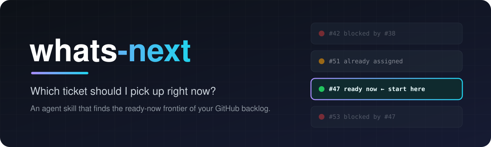
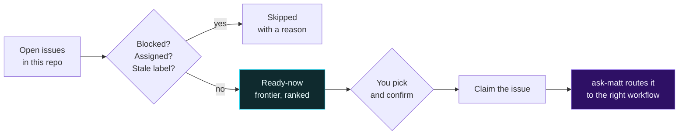

<p align="center">
  
</p>

<p align="center">
  
  
  
  
  <a href="LICENSE"></a>
</p>

<p align="center"><b>Stop guessing what to work on. Ask <code>/whats-next</code>.</b></p>

# `/whats-next` skill

Portable Agent Skill for Claude Code, GitHub Copilot, and OpenAI Codex. Finds the next session-ready ticket in the current GitHub repository, explains blockers and ranking, and optionally claims a chosen ticket and routes it through the `ask-matt` skill.

## How it works



## Why I made it

This skill complements [Matt Pocock's skills](https://github.com/mattpocock/skills). His workflow is great at turning ideas into PRDs and breaking them into small, dependency-linked GitHub issues, then driving each ticket through a focused session. What it doesn't answer is the question I kept asking at the start of every session: *which ticket should I pick up right now?*

Once a backlog has a few dozen issues with blockers, sub-issues, and dependencies buried in descriptions, figuring that out by hand is slow and error-prone. It's easy to grab something that's still blocked, collide with work someone else already owns, or trust a `ready-for-agent` label that's out of date.

`whats-next` closes that gap. It reads the current repo's open issues, checks real blocking relationships and assignees, shows the "ready now" frontier with transparent reasoning, and, only after you confirm, claims the ticket and hands it to `ask-matt` to route into the right Matt Pocock workflow.

## Contents

- `SKILL.md`: workflow and operating rules.
- `assets/banner.svg`: README banner.

## Install

Clone this repository into a personal skill directory. The installed path must end in `whats-next/SKILL.md`.

| Environment | Personal skill directory | Start using it |
| --- | --- | --- |
| Claude Code | `~/.claude/skills/whats-next/` | Start a new Claude Code session, then invoke `/whats-next`. |
| GitHub Copilot | `~/.agents/skills/whats-next/` (also recognized: `~/.copilot/skills/whats-next/`) | In Copilot CLI, run `/skills reload` if already in a session, then `/skills info whats-next`. Prompt `Use /whats-next` to run it. |
| OpenAI Codex | `~/.agents/skills/whats-next/` | Start a new Codex session and ask it to use `$whats-next` or "What should I work on next?" |

### Windows PowerShell

```powershell
git clone https://github.com/huvanile/whats-next "$HOME\.claude\skills\whats-next"   # Claude Code
# git clone https://github.com/huvanile/whats-next "$HOME\.agents\skills\whats-next" # GitHub Copilot or Codex
```

### macOS or Linux

```sh
git clone https://github.com/huvanile/whats-next ~/.claude/skills/whats-next   # Claude Code
# git clone https://github.com/huvanile/whats-next ~/.agents/skills/whats-next # GitHub Copilot or Codex
```

To update, run `git pull` inside the installed folder.

## Use

Invoke `/whats-next` in Claude Code or GitHub Copilot, or `$whats-next` in Codex. The skill inspects only the current repository. It recommends work read-only and never assigns an issue without your explicit confirmation. After a verified claim, it uses `ask-matt` to route the appropriate workflow.

## Official installation references

- [Claude Code skills](https://code.claude.com/docs/en/skills)
- [GitHub Copilot agent skills](https://docs.github.com/en/copilot/concepts/customizations/agent-skills)
- [GitHub Copilot CLI skills](https://docs.github.com/en/copilot/how-tos/copilot-cli/customize-copilot/add-skills)
- [Codex skills](https://developers.openai.com/codex/skills)
